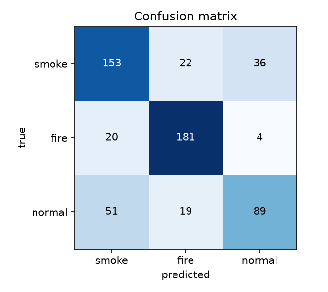

# Fire Detection System: AI part

On-device smoke and fire recognition for a solar-powered IoT node mounted on a tree.
The node is meant to spot a wildfire early and send the alert over LoRaWAN.

This repository is the **AI part** of a 6-week group project (Challenge 3, ICT, Fontys University of Applied Sciences):

* an image classifier that runs on an **ESP32-CAM**;
* the logic on the **Arduino MKR WAN 1300** that combines gas sensors, camera and flame sensor into one alarm decision;
* the Python tools used to build the dataset and evaluate the model.

```
gas anomaly ──► MKR sends "CAPTURE" ──► ESP32-CAM: 3 frames ──► MobileNetV1 (int8) ──► vote
            ◄── "RESULT,smoke,0.87,2/3" ◄──────────────────────────────────────────────┘
MKR fusion (gas + camera + flame) ──► IDLE / SUSPECT / ALARM ──► LoRaWAN message (12 bytes)
```

Only a label, a confidence and a vote count leave the camera, never the image.

## Status

| Part | State |
|------|-------|
| Dataset tools, upload to Edge Impulse | ✅ done, tested |
| Model v2 (MobileNetV1 0.25, 96x96 RGB, int8) | ✅ trained, evaluated on the laptop |
| Camera firmware with the real model | ✅ compiles for the ESP32-CAM (40% flash, 20% RAM) |
| MKR fusion library | ✅ compiles for the MKR WAN 1300, 48 unit tests pass on the laptop |
| Test on the real hardware, own camera images | ⏳ next step |

### Model results

Interim test set: 575 held-out D-Fire images. A test set with own ESP32-CAM images follows.

| Version | Change | Accuracy | Hazard recall @0.70 | False alarms @0.70 |
|---------|--------|----------|---------------------|--------------------|
| v1 | first try, all D-Fire images | 58% | 46% | 8% |
| **v2** | tiny smoke removed, resize matches the camera | **74%** | **69%** | 13% |
| v3 | MobileNetV2 0.35 | 66% | 53% | 11% |

v3 is better in float32, but loses a lot in int8 quantisation and is slower, so **v2 is used**.
These are per-frame numbers. On the node, 2-of-3 frame voting and the gas+camera fusion cut false
alarms further. Details: [docs/model-card.md](docs/model-card.md).



## How it works

1. **Trigger (FR01).** The camera stays idle until the MKR sees a gas anomaly and sends `CAPTURE`.
2. **Classify (FR02/FR03).** The camera takes 3 frames. Each frame is classified as `smoke`, `fire` or `normal`.
   Fog, steam, dust, shadows, sky and clouds belong to `normal`; that is how false triggers are filtered.
3. **Confidence and vote (FR04/FR05).** A frame counts as a hazard when its smoke or fire score is ≥ 0.70.
   With at least 2 of 3 hazard frames, the camera answers `smoke` or `fire`.
4. **Fusion (R11).** The MKR combines the answer with the gas and flame sensors:

   | Gas | Camera | Flame | Result |
   |-----|--------|-------|--------|
   | no | not asked | any | nothing |
   | yes | smoke / fire | any | **ALARM** |
   | yes | normal | yes | **ALARM** (covers night) |
   | yes | normal | no | **SUSPECT** → check again after 30 s, **ALARM** if the gas stays |

More detail: [architecture](docs/architecture.md) · [UART protocol](docs/uart-protocol.md).

## Repository layout

| Path | What |
|------|------|
| [`docs/`](docs) | Architecture, UART protocol, model card, test log template |
| [`firmware/esp32cam_inference/`](firmware/esp32cam_inference) | Camera sketch: waits for `CAPTURE`, classifies, answers. `USE_MOCK_MODEL` for tests without a model |
| [`firmware/esp32cam_collector/`](firmware/esp32cam_collector) | Web page with smoke/fire/normal buttons to collect training photos |
| [`firmware/mkr_fusion/`](firmware/mkr_fusion) | Arduino library for the MKR: `CameraLink`, `FireFusion`, `LoraPayload`, plus laptop tests |
| [`dataset_tools/`](dataset_tools) | D-Fire conversion, cleaning and split, statistics, Edge Impulse upload |
| [`evaluation/`](evaluation) | Run the model on the laptop, confusion matrix, false-alarm counting |
| [`models/`](models) | Trained models (`.lite`), metrics, Edge Impulse Arduino library |

## Hardware

| Board | Role |
|-------|------|
| ESP32-CAM (AI-Thinker, OV2640) | Image capture and inference |
| Arduino MKR WAN 1300 | Sensor hub (MQ-7, MQ-9, MQ-135, MH-Z19, BME280, flame sensor), fusion, LoRaWAN |

Camera link: UART at 115200 baud, 3.3 V on both sides. ESP32-CAM GPIO14 (TX) → MKR D3, MKR D2 → GPIO13 (RX),
common GND. The MKR uses an extra UART on SERCOM0 because `Serial1` is taken by the CO2 sensor.

## Getting started

### Requirements

* Python 3.10 – 3.12 (3.15 alpha does not work with Pillow)
* [`arduino-cli`](https://arduino.github.io/arduino-cli/) or Arduino IDE 2, with the `esp32:esp32` and `arduino:samd` cores

```bash
python3.12 -m venv .venv && source .venv/bin/activate
pip install -r requirements.txt
```

```bash
arduino-cli config init --additional-urls https://espressif.github.io/arduino-esp32/package_esp32_index.json
arduino-cli core update-index && arduino-cli core install esp32:esp32 arduino:samd
```

### Try it without hardware

Fusion logic and UART parser, with a simulated camera and clock:

```bash
firmware/mkr_fusion/extras/host_test/run_tests.sh
```

Run the model on a folder of images (`<folder>/<class>/*.jpg`) and score it:

```bash
python evaluation/predict_tflite.py --model models/fire_v2b_int8.lite --images data/processed/test
python evaluation/confusion_matrix.py evaluation/out/predictions.csv --threshold 0.7 --sweep
```

### Build the dataset

Download D-Fire from its [GitHub page](https://github.com/gaiasd/DFireDataset) and unzip it into `data/raw`, then:

```bash
python dataset_tools/convert_dfire.py --src data/raw --out data/dfire --per-class 1500
python dataset_tools/preprocess.py --dfire data/dfire --own data/own --out data/processed
python dataset_tools/stats.py data/processed
python dataset_tools/upload_edge_impulse.py data/processed     # needs EI_API_KEY in .env
```

### Flash the boards

Install the Edge Impulse library once:

```bash
arduino-cli config set library.enable_unsafe_install true
arduino-cli lib install --zip-path models/ei_arduino_library_v2.zip
```

Camera (put IO0 on GND for upload, then remove the jumper and replug):

```bash
arduino-cli compile --fqbn esp32:esp32:esp32cam firmware/esp32cam_inference
arduino-cli upload  --fqbn esp32:esp32:esp32cam -p <port> firmware/esp32cam_inference
```

Open the serial monitor (115200, "Newline") and type `CAPTURE` to test it without the MKR.

MKR: link `firmware/mkr_fusion` into your Arduino `libraries` folder and open the `fusion_demo` example.
In its serial monitor, `g` toggles a fake gas anomaly and `f` a fake flame.

### Secrets

Wi-Fi passwords and API keys are never committed (requirement R24). Copy `secrets.example.h` to
`secrets.h` and put the Edge Impulse key in `.env`. Both are in `.gitignore`.

## Open points

* Confirm the camera UART pins (D2/D3) and the 12-byte LoRa payload layout with the sensor/LoRa team.
* Collect own ESP32-CAM images, retrain, and use them as the final test set.
* Measure inference time and current on the real board.

## Credits and license

* Dataset: [D-Fire](https://github.com/gaiasd/DFireDataset), Venâncio et al. (images not included here).
* Model training: [Edge Impulse](https://edgeimpulse.com).
* Hardware and sensor code: the Fire Detection System project group.

Code in this repository: [MIT](LICENSE). The Edge Impulse library in `models/` keeps its own license (BSD 3-Clause Clear / Apache 2.0).
